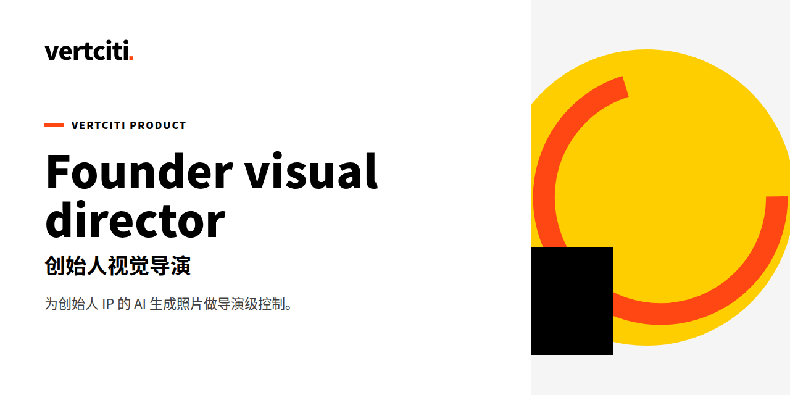

# founder-visual-director · 创始人视觉指导

[English](README.md)

[](LICENSE)
[](SKILL.md)

**看起来廉价的 AI 创始人照片会摧毁可信度。这个技能是片场的导演：它把一份场景简报变成可执行的图像 prompt、一份写实度 QA 清单，以及一份轮换合规结论——在任何东西发布之前。**

[官网](https://vertciti.com) · [快速开始](#快速开始) · [诚实约定](#诚实约定) · [测试实证](#测试实证)

> founder-visual-director 是 vertciti 为创始人自用的 AI 视觉生产指导工具。状态：Version 1.0.0；`evals/` 冒烟评估（进行中）。

## 快速开始

```bash
cd demo
python3 run.py < input.json
# Output lands in demo/output/ (prompt.txt, checklist.md, rotation.md)
```

见 `demo/README.md` 了解最小可运行切片（零外部依赖）。

## 它做什么

一个 [Vertciti Skill Pack](https://vertciti.com)，用于导演级把控 AI 生成的创始人摄影。一份场景简报进来，三部分交付物出去——覆盖 Xiaohongshu、Instagram 和 LinkedIn 的创始人封面与配图。

为 [Miao](https://vertciti.com)（Jiahui Miao）而建——N=1 创始人 IP 基础设施。

### 它解决的真实问题

AI 生成的创始人图像会以三种可重复的方式翻车：恐怖谷面孔与破碎的物理（手、反射、光线方向），以及视觉重复（同样的服装、同样的造型、同样的背景连发两帖——观众比你先注意到）。founder-visual-director 把护栏机制化：全尺寸写实度检查，任一红线不过即全图重生成；并按带冷却规则的资产台账做轮换合规检查。

### 它交付什么

每次运行产出三部分：

1. **图像 prompt** —— 可执行的正向 prompt + 固定的负向词块 + 禁用词 grep 结果 + 冲突审计（简报 vs 常设规则）。
2. **QA 清单** —— 面部角度规则 → 10 点比例检查 → 写实度通过（解剖 / 物理 / 全局一致性）→ 背景物理。任一红线不过 = 全图重生成，不打补丁。
3. **轮换合规** —— 对照资产台账检查（最近 3 帖、冷却期、白底头像禁用、相邻帖服装/造型重复规则）。结论：**pass** / **conditional** / **violation** + 整改办法。

### Demo

一套完整的工作输出附带在 `demo/output/` 中：

- `prompt.txt` —— 由示例简报生成的可执行图像 prompt
- `checklist.md` —— 产出的完整写实度 QA 清单
- `rotation.md` —— 基于示例资产台账的轮换合规结论

> 三部分交付物在真实发布中被使用的 demo 录像/截图：待补（占位）——上面的输出文件已经真实；可视化 walkthrough 在计划中。

### 何时使用

| 场景 | 产出 |
|---|---|
| 下一帖的 Xiaohongshu 封面 | 为平台调校的可执行 prompt + QA 清单 |
| IG 日常配图，服装必须不同 | 轮换结论阻断同造型重复 |
| LinkedIn 职业肖像 | 可信度优先的指导，无网红感 |
| 上线新的视觉系列 | 对照台账做背景/场景/对比度差异化 |

### 仓库结构

```
founder-visual-director/
  SKILL.md      # the skill itself: director protocol, input contract, red lines
  demo/         # 30-second slice: input.json → output/(prompt.txt, checklist.md, rotation.md)
  references/   # visual spec v1.6/v1.7, asset rotation rules
  evals/        # smoke evaluations (in progress)
``` 一套完整的工作输出附带在 `demo/output/`。

### 输入契约

这个技能拒绝臆造简报。调用方必须至少提供：

| 字段 | 示例 |
|---|---|
| 主题 / 平台 / 内容线 | 小红书第 10 篇 / IG daily / LinkedIn 行业观点 |
| 场景需求 | 晨跑后拉伸，城市阳台 |
| 氛围 | 平静的自信，电影感 |
| 轮换上下文 | 最近 3 帖的服装、场景、背景 |

缺失字段会被追问，不会被编造。需要配套的 `founder-visual-studio` 技能（拍摄规划）与 visual spec v1.6/v1.7；轮换规则在 `references/` 中。

## 诚实约定

- 每个数字标注来源与抓取时间；抓不到的标“需手动补”，绝不编数。
- 白底标准头像**绝不**用作内容配图。
- 每张图在发布前都要做全尺寸视觉检查——缩略图不算。
- 相邻帖同服装 / 同造型 = 重复（驳回）。
- 生成的背景必须与近期背景明显不同——不许懒惰换皮。
- 若使用 AI 生成或深度修图的人像，须在图注标明。
- 本产品不做什么：见 FAQ——“它能替代人类艺术总监吗？不能。”
- 输出为辅助结论，不构成投资、法律或税务建议。

## 测试实证

| 指标 | 数字 | 来源 · 数据截至 |
|---|---|---|
| demo 评估（`bash demo/eval.sh`） | PASS：三部分交付物齐全，契约字段完整 | 本地运行 `demo/eval.sh` · 2026-10-21 |
| 快速开始复跑（`python3 run.py < input.json`） | 再生成输出与仓库已提交 `demo/output/` 三件逐字一致 | 本地运行 `demo/run.py` · 2026-10-21 |
| 冒烟评估记录 | `evals/smoke-01.md`（完整 dry-run，原文保留） | `evals/smoke-01.md` · 2026-10-21 |

## 路线图

- `evals/` 冒烟评估，带并排相似度判定（进行中）。
- 轮换台账自动化：用机器 diff 把新简报与已发布资产日志比对。
- 平台扩展规则（TikTok 已进入常设发布排期）纳入轮换合规。

## FAQ

**为什么不直接描述场景、让模型自己决定？**
模型会默认走向其训练数据的平均值——同样的灰西装、同样的办公室窗户。导演的工作就是强迫差异：背景、光线、取景、氛围全部写明，并全部对照已发布内容检查。

**“红线不过 = 全图重生成”在实际中意味着什么？**
手画错了、反射不可能、光线方向不一致——任一出现都意味着从头来。用“把手修一下”给生成图打补丁会摧毁全局一致性；QA 清单机械地执行这一点。

**轮换合规怎么知道发过什么？**
对照资产台账：最近 3 帖的服装、场景、背景，外加冷却规则。相邻帖同服装 / 同造型 = 重复，驳回。台账就是模型没有的那份记忆。

**它能替代人类艺术总监吗？**
不能。它替代的是“忘了检查”这个环节。全尺寸人工检查在发布前仍是红线——这个技能确保检查时有真东西可查。

## 参与贡献

欢迎 Issues 和 PRs。视觉质量主张需要全尺寸的前后对比证据，不要形容词。

## 作者

**Jiahui Miao** —— [vertciti](https://vertciti.com) 创始人。正在构建 N=1 个人 AI 基础设施。参与 3GPP，从事 6G 核心网标准工作。

## 关于 vertciti

vertciti 把全部资源用来运营一个人的人生：创始人苗家辉。官网 [vertciti.com](https://vertciti.com) · 仿冒预警：vertciti 从未发行任何代币。

## 许可证

| 模块 | 许可证 | 白话含义 |
|---|---|---|
| 全部文件 | MIT | 可商用、可修改、需署名 |

见 [LICENSE](LICENSE)。

MIT · 运营主体 VERTCITY LLC
