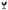

# B1 · 破土 · 双叶裂土

方向：破土（次选）。苗独立成纹，不带虎。

 

左：线稿（蜡印正读）。右：剪影（内部线全灭）。虚线为净刻面边界，不入刻。

## blazon（文字描述）

A seedling of two leaves issuant from a mount, the mount broken about the stem.

双叶苗自土丘中出，土丘在茎的两侧裂开。

## 构图逻辑

- **一个物**：一棵苗。一茎直上，到中部分成两片叶，左叶略小，两叶外弓。每片叶一道叶脉（留金的负线）。〔T-01、T-10〕
- **破土**：底部的土丘不是一整块，而是被茎顶开的左右两块，茎两侧各留一道 0.34mm 的缝。两块土一高一低，表示是刚被顶开的。
- **长轴构图**：茎沿长轴；叶占上半、土占最下一条。叶的面积远大于土，所以重心在中心上方 0.13mm。
- 土丘是纹章里的 mount，属于苗这个主纹的一部分（「issuant from a mount」），不是第二个物。

## 出处逻辑

- 苗＝名（谐名），也是「初苗」「始于一苗」的字面。〔T-09、T-13〕
- 植物独立撑起一个家的主纹，先例是 Grosvenor 的麦束与德川的葵。〔T-11〕
- 「生」字的甲骨文就是这个形：一株草木（屮）从地面（一）长出来；《说文》：「生，进也。象艸木生出土上。」这是字源上的事实，不是家史上的主张。

## 引用的可偷清单

T-01、T-09、T-10、T-11、T-13。

## 读数（实寸核对）

量测对象是本稿渲染后的位图（200 px/mm），方法见目录 README。

| 项 | 读数 | 规格门 | 判定 |
|---|---|---|---|
| 主纹高 | 8.49mm，占净刻面高 83.3% | 80–90% | 过 |
| 主纹宽 | 4.86mm，占净刻面宽 59.3% | — | — |
| 距净刻面边最近处 | 0.18mm | 不触边距（>0） | 过 |
| 最小线（黑） | 0.178mm，在 (-2.0, 3.83) | ≥0.15 | 过 |
| 最小间隙（通向底子的白） | 0.244mm，在 (0.0, -0.46) | ≥0.20 | 过 |
| 内部负空间（被主纹围住的白） | 2 处，最窄 0.349mm | ≥0.30 | 过 |
| 重心相对椭圆中心 | x +0.27，y -0.13（负＝偏上） | 略高于中心 | 过 |
| 下刀面积占净刻面 | 21% | — | — |

坐标单位 mm，原点在椭圆中心，x 向右、y 向下（蜡印正读）。

## 实寸读图自检

- 线稿，12x10 实寸：一口叫得出苗。
- 线稿，32px：仍是苗。
- 剪影：仍是苗。**线稿与剪影都通过。**

## 已知弱点（交大师轮）

1. 下刀面积只占净刻面 21%，面上留金多。好处是耐磨、工时短；坏处是与「主纹独占整块净刻面」的观感有距离——高度占满了，宽度只占 59%。
2. 双叶苗是极常见的图形（环保、农业、理财类商标里到处都是）。**撞纹风险是全部稿件里最高的**，撞纹检索未做。
3. 两块土各自是独立的小岛（最小线 0.178mm 就在左土块的尖上），磨损后最先变形。
4. 这一稿里没有虎。若终裁以虎为主纹，本稿可退为全徽文档里的徽章（badge）位备选。
