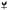

# B2 · 破土 · 一苗

方向：破土（次选）。苗独立成纹，不带虎。

 

左：线稿（蜡印正读）。右：剪影（内部线全灭）。虚线为净刻面边界，不入刻。

## blazon（文字描述）

A seedling of two leaves rising from a bar, its root below.

双叶苗立于一道横线之上，线下一条根。

## 构图逻辑

- **三笔**：一道横线、线上一棵苗、线下一条根。横线就是地面，也是「一」字——「始于一苗」的「一」。〔T-09〕
- 苗与 B1 同形（同一棵苗）。根只有一条主根带一条侧根，比苗小得多，所以重心仍不低于中心。
- 与 B1 的区别：B1 画的是「顶开土」这个动作；B2 画的是「地上地下」这个结构，更静，更像一个记号。
- 横线两端是圆头，不通到椭圆边——它是主纹的一笔，不是框线，也不是把面分成上下两区的分割线。

## 出处逻辑

- 同 B1：苗＝名；「生」字的字源形（屮在一上）。B2 比 B1 更贴近这个字源形。〔T-11、T-13〕
- 风险也在这里：屮在一上，本身近于一个字。若被读作「生」或「土」「上」，就成了文字入面。本稿用了写实的叶形和根来避开，但这一点请大师轮留意。

## 引用的可偷清单

T-01、T-09、T-10、T-11。

## 读数（实寸核对）

量测对象是本稿渲染后的位图（200 px/mm），方法见目录 README。

| 项 | 读数 | 规格门 | 判定 |
|---|---|---|---|
| 主纹高 | 8.35mm，占净刻面高 81.8% | 80–90% | 过 |
| 主纹宽 | 6.06mm，占净刻面宽 73.9% | — | — |
| 距净刻面边最近处 | 0.22mm | 不触边距（>0） | 过 |
| 最小线（黑） | 0.195mm，在 (-1.93, -3.22) | ≥0.15 | 过 |
| 最小间隙（通向底子的白） | 0.241mm，在 (-0.06, -0.49) | ≥0.20 | 过 |
| 内部负空间（被主纹围住的白） | 2 处，最窄 0.352mm | ≥0.30 | 过 |
| 重心相对椭圆中心 | x +0.23，y -0.01（负＝偏上） | 略高于中心 | 过 |
| 下刀面积占净刻面 | 23% | — | — |

坐标单位 mm，原点在椭圆中心，x 向右、y 向下（蜡印正读）。

## 实寸读图自检

- 线稿，12x10 实寸：一口叫得出苗。
- 线稿，32px：仍是苗（横线清楚，根只剩一个小尾）。
- 剪影：仍是苗。**线稿与剪影都通过。**

## 已知弱点（交大师轮）

1. 侧根末端是全图最细处（设计宽 0.2mm 的圆头），磨损后会消失；消失后图仍成立。
2. 主纹高占 81.8%，贴近 80% 下限。
3. 撞纹风险同 B1。苗加一道横线的组合更少见些，但未检索，不能当作结论。
4. 一道横线加一竖，远看近于十字或「干」字形。实寸下叶子把它拉回了「苗」，但小于 32px 时要注意。
