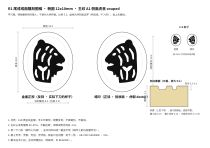

# R1 · 尾戒戒面雕刻图稿 · 椭圆 12x10mm

A5 横幅图纸（210x148mm），比例 5:1。主纹用 A1（侧面虎首 couped，规格案一，中枢倾向）。换主纹只需在 `tools/build.py` 里改一个名字，图纸其余部分不变。

## 图上有什么

| 区 | 内容 |
|---|---|
| 左 | **金面正视**：实际下刀的样子，主纹是反的（虎朝观者右）。实线椭圆＝戒面外缘 12.0x10.0；虚线椭圆＝净刻面 10.2x8.2（边距 0.9），只是构造线，**不入刻**。 |
| 中 | **蜡印**：正读，虎朝 dexter（观者左）。这是验收面——所有量测门都在这一面上量。 |
| 右上 | 金面与蜡印的 1:1 实寸对。按 100% 打印后目视读图用。 |
| 右下 | 刻口截面示意：面厚 ≥2.3、刻深 0.3–0.5、斜壁、平底。 |
| 下 | 五条刻制注记。 |

金面图由蜡印图左右镜像生成，不单独画，所以两者不会不一致。〔T-16、T-26〕

## 按定版规格逐条核对

| 规格条 | 本图 |
|---|---|
| 椭圆 12x10，净刻面 10.2x8.2，边距 0.9 | 按此绘制；面外缘与净刻面边界都画出 |
| 无框线 | 面上除主纹外无任何线；虚线标明不入刻 |
| 单一主纹独占净刻面；无缎带、无冠、无环铭 | 只有虎首 |
| 主纹占净刻面高 80–90%，不触边距 | 85.2%；距净刻面边最近 0.21mm |
| 最小线 0.15／最小间隙 0.20／内部负空间 ≥0.30 | 0.197／0.246／0.333 |
| 兽在蜡印上朝 dexter，戒面反刻 | 是 |
| 长轴构图、居中、重心略高 | 长轴竖置；重心在中心上方 0.07mm |
| 纯金面、印章刻、深 0.3–0.5、斜壁 | 截面示意按此；图稿只定平面形，深度与壁角由雕刻师定 |
| 格言不入戒面 | 面上无字 |
| 叙事属性禁入 | 无 |

读数来源与方法见 A1 说明与目录 README。

## 整戒比例口径（其余三视本轮未出图）

规格定死的：

- 面：椭圆 12.0 x 10.0mm；面厚 ≥2.3mm；刻后最薄处 ≥1.8mm（面厚 2.3 减最大刻深 0.5）。
- 净刻面与面之比：长 10.2/12.0 ＝ 0.85，宽 8.2/10.0 ＝ 0.82。
- 肩：英式素肩，只收弧成形，不刻纹，不重复主纹。〔T-15〕
- 内圈：连续正刻「始于一苗 · AB UNO GERMINE · 001」。

下面是**建议的起点，不是规格**，都要在大师轮按实际指围与克重定：

- 长轴沿手指方向（竖置）。侧视时面与戒臂的过渡是一条连续的弧，面缘不起台阶。
- 戒臂在掌侧最窄处的宽度约为面宽的三分之一（3.0–3.5mm），厚 1.5–1.8mm；自面缘到此处匀速收窄。
- 内圈字高 1.2–1.5mm。按字高 1.4mm 粗估，全句排开约 27mm（估算：汉字 4 个、拉丁字母 14 个、数字 3 个，加分隔与字距），小指戒的内周一般在 47–53mm 之间，所以全句约占内周的一半到六成，对着面的背面居中起排，两端留白。这两个数都是估算，没有实排。
- 佩戴朝向：主纹顶朝指尖（对方可读）。此项待裁，见目录 README。〔T-18〕

## 没有做的

- 侧视、俯视、内圈展开图：没有出图。
- 13x11 上限面档：没有出图。
- 内圈刻字的字体：没有选。
- 刻深的行业对照：规格的 0.3–0.5mm 在公开资料里找不到任何工坊给出的数字可对照（拆解报告 §1.8），这个数需要雕刻师实刻确认。
- 没有实刻，没有压蜡。本图是输入，不是验收结果。

## 引用的可偷清单

T-15、T-16、T-18、T-26。
